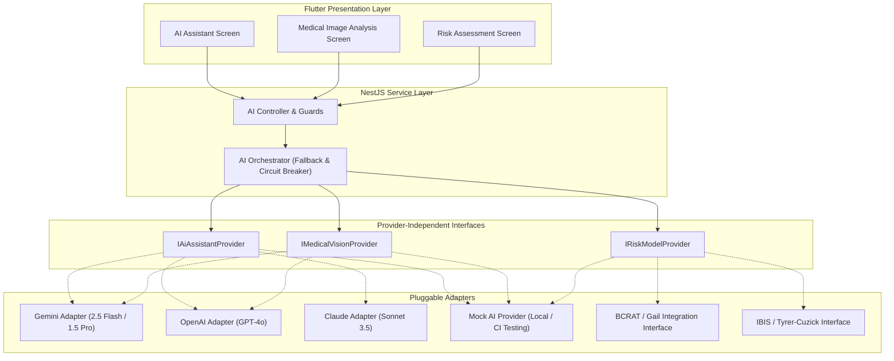
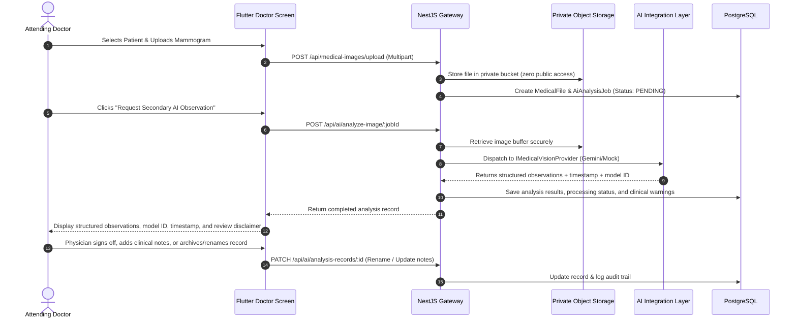

# Lumyra — AI Integration Architecture & Model-Agnostic Interface Plan

**Product Name**: Lumyra — Cross-Platform Breast Health Companion  
**Version**: 1.1.0 (Scope Clarified)  
**Classification**: AI Systems & Clinical Decision Support Architecture  
**Date**: October 2026  
**Status**: Models Deferred / Model-Agnostic Abstraction Layer Active  

> [!IMPORTANT]
> **Scope Clarification**: The final conversational AI models, medical imaging evaluation models, and breast cancer risk-calculation models have **NOT** been selected yet.
> Lumyra implements **provider-independent interfaces** and **deterministic placeholder/mock adapters** for local development, UI prototyping, and testing. No production model is chosen, installed, or coupled to the frontend code. Real model selection and backend integration will occur in a dedicated future phase once requirements and clinical evaluations are finalized.

---

## 1. Core Principles & Model-Agnostic Boundaries

The integration of Artificial Intelligence in Lumyra adheres to strict healthcare engineering ethics, international standards for Software as a Medical Device (SaMD), and regulatory risk containment:

1. **Provider Independence**: Core application logic and Flutter UI widgets interact exclusively with generic, strongly-typed internal interfaces. Replacing, upgrading, or falling back across AI vendors (Google Gemini, Anthropic Claude, OpenAI, or local open-weights models) requires zero code modifications to client screens or domain models.
2. **Server-Side Isolation**: All AI provider API keys, model identifiers, secret credentials, and raw prompts remain strictly on the backend server. The client never communicates directly with third-party AI endpoints.
3. **No Unvalidated Clinical Claims**: Lumyra **never** claims that an AI model has been trained, fine-tuned, clinically validated, or certified unless empirical clinical trial evidence and regulatory clearance exist.
4. **Non-Diagnostic Nature & Physician Primacy**: General-purpose multimodal LLMs are not diagnostic devices. All AI outputs are labeled as educational observations or supportive information, with mandatory clinical disclaimers requiring evaluation by a board-certified physician.
5. **Zero Autonomous Medication Intervention**: The conversational AI and risk engines are strictly constrained: they **never** recommend medication dosages, suggest stopping prescriptions, or initiate pharmacological interventions.

---

## 2. Provider-Independent Architecture & Adapter Pattern



---

## 3. Interface Definitions

### 3.1 Conversational Health Companion (`IAiAssistantProvider`)
```typescript
export interface AiChatMessage {
  role: 'user' | 'assistant' | 'system';
  content: string;
  timestamp: string;
}

export interface AssistantRequest {
  userId: string;
  userRole: 'PATIENT' | 'DOCTOR';
  messages: AiChatMessage[];
  language: 'ar' | 'en';
  contextualMetadata?: {
    patientAgeBracket?: string;
    recentMood?: string;
  };
}

export interface AssistantResponse {
  replyText: string;
  provider: string;
  model: string;
  tokensUsed?: number;
  safetyFlags: {
    emergencyEscalationTriggered: boolean;
    medicalDisclaimerAppended: boolean;
  };
  suggestedFollowUps?: string[];
}

export interface IAiAssistantProvider {
  generateReply(request: AssistantRequest): Promise<AssistantResponse>;
}
```

### 3.2 Secondary Medical Image Observation (`IMedicalVisionProvider`)
```typescript
export interface ImageAnalysisRequest {
  jobId: string;
  fileBuffer: Buffer;
  mimeType: string;
  modality: 'MAMMOGRAM' | 'ULTRASOUND' | 'XRAY';
  requestingDoctorId: string;
  patientId: string;
}

export interface ImageAnalysisObservation {
  densityObservation?: string;
  structuralNotes: string[];
  findingsSummary: string;
  clarityAssessment: 'SUFFICIENT' | 'SUBOPTIMAL' | 'UNCLEAR';
}

export interface ImageAnalysisResult {
  jobId: string;
  provider: string;
  model: string;
  status: 'COMPLETED' | 'FAILED';
  analysisTimestamp: string;
  observations: ImageAnalysisObservation;
  clinicalDisclaimer: string;
  processingDurationMs: number;
}

export interface IMedicalVisionProvider {
  analyzeScan(request: ImageAnalysisRequest): Promise<ImageAnalysisResult>;
}
```

---

## 4. Provider Implementation & Fallback Strategy

### 4.1 Supported Provider Adapters
1. **Google Gemini Adapter (`GeminiProvider`)**:
   - Primary high-efficiency provider leveraging `gemini-2.5-flash` for high throughput Arabic conversational responses and image analysis.
   - Secondary high-reasoning fallback on `gemini-1.5-pro`.
   - Utilizes `responseMimeType: 'application/json'` to enforce structured object generation.
2. **OpenAI Adapter (`OpenAiProvider`)**:
   - Secondary conversational and vision fallback using `gpt-4o`.
3. **Anthropic Claude Adapter (`ClaudeProvider`)**:
   - Alternative fallback for complex natural language communication.
4. **Deterministic Mock Provider (`MockAiProvider`)**:
   - Local development and automated testing engine.
   - Returns instant, deterministic, zero-cost conversational responses and structured imaging outputs without requiring internet access or API keys.
   - Explicitly flags outputs with `provider: "mock-provider-offline"`.

### 4.2 Resilience & Circuit Breaker Architecture
To ensure high availability and prevent cascade failures:
- **Request Timeout**: Strict 15-second timeout on conversational queries; 30-second timeout on image analysis.
- **Circuit Breaker**: After 3 consecutive timeouts or 5xx errors from an external provider, the orchestrator opens the circuit for 60 seconds and immediately routes traffic to the fallback provider.
- **Output Sanitization & Validation**: Raw AI text is never trusted. All LLM JSON responses are passed through Zod schemas before being accepted. Malformed responses trigger an automatic retry or graceful error response to the user.

---

## 5. Clinical Safety & Conversational Guardrails

### 5.1 Emergency Detection & Safe Escalation
If a patient inputs symptoms indicating acute medical emergencies (e.g., severe acute chest pain, uncontrolled bleeding, sudden respiratory distress, acute suicidal ideation), the system intercepts the message via regex and semantic classifier, responding immediately with localized emergency contact directives:
- Egypt Ambulance Emergency: `123`
- Egypt Ministry of Health Hotline: `105`
- Immediate instructions to present to the nearest hospital emergency room.

### 5.2 Mandatory System Directives (System Prompts)
Every conversational prompt includes strict, unalterable system boundaries:
1. **Empathy & Validation**: Acknowledge emotions, alleviate acute anxiety, and offer calm reassurance.
2. **Medical Education Only**: Provide structured health education based on WHO and NCI guidelines.
3. **Never Diagnose**: Never formulate a definitive clinical diagnosis or pronounce certainty regarding malignancy or benignity.
4. **Never Alter Treatment**: Never suggest altering prescribed drug dosages or scheduling.
5. **Always Advise Consultation**: Conclude responses with an invitation to discuss questions with the patient's attending oncologist or physician.

---

## 6. Breast Cancer Risk Assessment Strategy

### 6.1 Honest Analysis of Validated Risk Models
The reference project claimed integration with the Gail Model, Tyrer-Cuzick, and BRCAPRO, but merely summed arbitrary heuristic integers. In Lumyra, we maintain clinical integrity:

| Model Name | Intended Clinical Purpose | Input Requirements | Mathematical Formulation & Execution Requirements | Lumyra Implementation Approach |
| :--- | :--- | :--- | :--- | :--- |
| **Gail Model (BCRAT)** | Projects 5-year and lifetime invasive breast cancer risk for women >35 with no prior history of breast cancer or LCIS. | Current age, age at menarche, age at first live birth, number of 1st-degree relatives, number of breast biopsies, presence of atypical hyperplasia, race/ethnicity. | Complex statistical integration of relative risk estimates with age-specific baseline breast cancer incidence and competing mortality hazards. Available as an NCI SAS macro / C++ engine. | **Phase 1-4**: Implement the standard guided clinical questionnaire capturing all BCRAT fields. Calculate risk scores using a clearly documented internal risk stratification rubric. **Integration Interface**: Define `IBcratRiskCalculator` with documented requirements for future NCI algorithm engine linking. |
| **Tyrer-Cuzick (IBIS)** | Estimates 10-year and lifetime risk, incorporating extended family pedigree, breast density, and hormonal factors. | Extended family pedigree (maternal & paternal relatives), age at onset, bilateral cancer, ovarian cancer history, personal height, weight, HRT, menopause status, mammographic density (Volpara/BI-RADS). | Proprietary Mendelian Bayesian risk calculation combining low-penetrance genetic factors with environmental hazards. Distributed as commercial IBIS library (Wolfson Institute of Preventive Medicine). | **Phase 1-4**: Guided questionnaire collecting comprehensive pedigree and hormonal history. Clearly labeled as a structured risk assessment questionnaire, avoiding false claims of certified IBIS certification until commercial licensing is established. |
| **BRCAPRO** | Calculates Bayesian probability that an individual carries a deleterious BRCA1 or BRCA2 germline mutation. | Comprehensive family tree with cancer status, ages at diagnosis, genetic testing status of relatives. | Complex Mendelian likelihood calculations over pedigree graphs using Bayes' theorem, penetrance tables, and allele frequency distributions. (BayesMendel package in R). | **Phase 1-4**: Genetic red-flag identification (early-onset family history, male breast cancer, bilateral cancer, ovarian cancer). Provides clear mutation risk indicators and referral guidelines for clinical genetic testing. |

### 6.2 Lumyra's Guided Risk Assessment Structure
Lumyra organizes the risk evaluation into three transparent, accessible tiers:
1. **Tier 1: Personal Demographic & Menstrual History**: Age, menarche age, pregnancy & lactation history, BMI, lifestyle factors.
2. **Tier 2: Personal Medical & Biopsy History**: Previous breast biopsies, atypical hyperplasia diagnoses, history of chest radiation therapy before age 30, breast density indicators.
3. **Tier 3: Family Pedigree & Genetic Flags**: First- and second-degree relatives with breast or ovarian cancer, age of onset in relatives, bilateral cancers, known BRCA status in family.

### 6.3 Clear Distinction of Risk Metrics
The assessment results screen explicitly separates:
- **Short-Term (5-Year) Comparative Indicator**: Visualizing risk relative to the average demographic population.
- **Lifetime Risk Category**: Classified as Average (<15%), Moderately Increased (15–20%), or High (>20%), prompting specific screening guidelines (e.g., annual mammogram + breast MRI recommendation for high-risk individuals).
- **Genetic Referral Flag**: Clear indicator whether pedigree characteristics warrant formal genetic counseling.
- **Mandatory Physician Sign-Off**: Explicit reminder that questionnaires are screening tools, not clinical diagnoses, and must be reviewed with a qualified physician.

---

## 7. Medical Image Analysis Workflow for Doctors



### 7.1 Display Requirements
Every image analysis view in the Lumyra Doctor portal displays:
- **Provider & Model Name**: (e.g. `Google Gemini 2.5 Flash` or `Mock Testing Provider`).
- **Execution Timestamp**: Precise UTC timestamp of analysis.
- **Status Badge**: `COMPLETED`, `PENDING_REVIEW`, or `FLAGGED`.
- **Structured Findings**: Breast density estimation, architectural observations, mass description, and calcification pattern notes.
- **Physician Review Banner**: Prominent warning stating: *"Secondary automated observation only. This output is not a verified clinical diagnosis. Primary diagnostic decision must be made by the attending physician."*
- **Record Management**: Doctor capability to rename analysis records for clinical indexing or delete unneeded test runs with audit trail retention.
