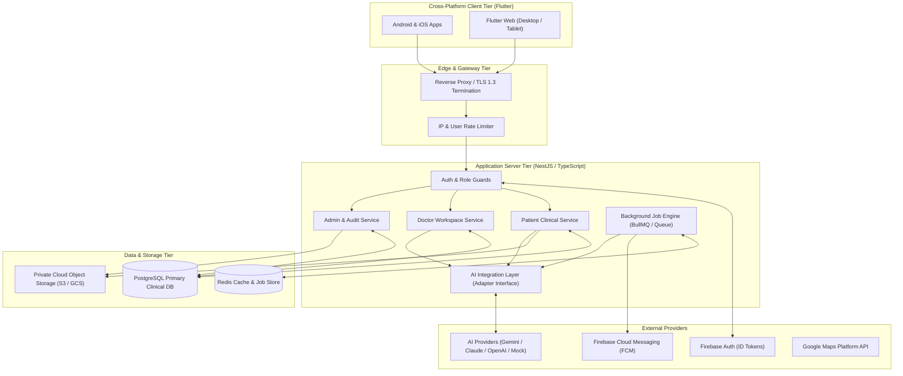
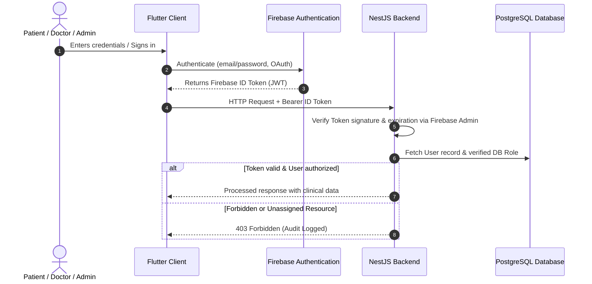

# Lumyra — System Architecture Document

**System**: Lumyra — Cross-Platform Breast Health Companion  
**Version**: 1.0.0-draft  
**Date**: October 2026  
**Status**: Approved for Implementation  

---

## 1. System Overview and Topology

Lumyra is designed as a secure, compliant, high-performance healthcare platform serving three distinct roles: **Patients**, **Doctors**, and **Administrators**. It consists of a unified cross-platform Flutter client application communicating over TLS 1.3 with a modular NestJS REST backend. The backend manages relational clinical records in PostgreSQL via Prisma ORM, interfaces with Firebase Authentication for identity federation, coordinates asynchronous background jobs, dispatches notifications via Firebase Cloud Messaging (FCM), and connects to pluggable AI providers through an isolated service abstraction layer.



---

## 2. Frontend Architecture (Flutter & Dart)

### 2.1 Core Technologies
- **Flutter Framework**: Version 3.29+ (Stable channel)
- **Dart SDK**: Version 3.7+
- **Target Platforms**: Android (minSdk 24, targetSdk 35), iOS (iOS 15+), Flutter Web (Wasm & CanvasKit)
- **State Management**: Flutter Riverpod 2.6+ with code-generation (`@riverpod`)
- **Routing**: `go_router` 14.8+ with nested shell routes and asynchronous redirect guards
- **Network Client**: `dio` 5.8+ with custom interceptors for auth tokens, token refresh, and correlation IDs
- **Secure Persistence**: `flutter_secure_storage` for biometric/token storage; `shared_preferences` for non-sensitive UI settings
- **Internationalization**: `flutter_localizations`, ARB-based localization with complete Right-to-Left (RTL) and Left-to-Right (LTR) support

### 2.2 Feature-First Project Structure
The frontend is organized strictly by feature modules, ensuring high cohesion, testability, and clean separation between presentation, state, domain, and data layers:

```
lib/
├── app/
│   ├── app.dart                   # Root MaterialApp with theme & localization
│   ├── router/
│   │   ├── app_router.dart        # go_router configuration & route definitions
│   │   └── route_guards.dart      # Role-based & auth state redirect logic
│   └── theme/
│       ├── app_colors.dart        # Blush & Sand Serenity palette tokens
│       ├── app_theme.dart         # Light & Dark ThemeData builders
│       └── app_typography.dart    # Plus Jakarta Sans & Cairo typography
├── core/
│   ├── errors/                    # AppExceptions, Failure models & error mappings
│   ├── network/                   # Dio client, API interceptors, endpoints
│   ├── security/                  # Secure token manager, biometrics, sanitizers
│   ├── utils/                     # Formatters, date helpers, responsiveness
│   └── widgets/                   # Reusable atomic UI (PillButton, AppCard, etc.)
└── features/
    ├── auth/                      # Login, Register, Password Reset, Verification
    ├── onboarding/                # Role selection, welcome walk-through
    ├── patient_dashboard/         # Patient home, quick actions, summary cards
    ├── patient_profile/           # Medical profile, language & notification settings
    ├── risk_assessment/           # Guided multi-stage breast health questionnaire
    ├── education/                 # Articles, video guides, bookmarks, categories
    ├── journal/                   # Private symptom & mood journal, history
    ├── appointments/              # Clinical appointment booking, status, reminders
    ├── medications/               # Medication tracker, schedule, adherence
    ├── medical_centers/           # Interactive map, directory, governorate filter
    ├── ai_assistant/              # Empathetic conversational health companion
    ├── notifications/             # In-app notification tray & FCM management
    ├── doctor_dashboard/          # Doctor home, assigned cohort, triaging
    ├── patient_management/        # Doctor view of patient charts & care history
    ├── image_analysis/            # Secondary AI image review & audit record viewer
    └── admin_dashboard/           # Doctor approval, user management, audit logs
```

### 2.3 MVVM Architectural Pattern
Every feature folder implements clean MVVM separation:
1. **View (`presentation/`)**: Pure declarative Flutter widgets. Reacts to ViewModel states via `ref.watch()`. Dispatches user actions via ViewModel methods.
2. **ViewModel (`presentation/viewmodels/`)**: Riverpod `AsyncNotifier` or `Notifier`. Handles UI state machines, form validation, error mapping, and invokes Repositories.
3. **Domain Models (`domain/`)**: Immutable data classes (`freezed` or pure Dart classes) representing domain entities and business rules.
4. **Repository (`data/repositories/`)**: Abstract interfaces and concrete implementations bridging local caching and remote data sources.
5. **Service / Data Source (`data/datasources/`)**: Direct HTTP calls via Dio, parsing raw JSON into strongly-typed DTOs.

### 2.4 Responsive Layout Strategy
To seamlessly support Mobile, Tablet, and Desktop Web within one codebase, Lumyra uses an adaptive design system based on screen width breakpoints:

| Device Category | Breakpoint (Width) | Navigation Pattern | Layout Structure |
| :--- | :--- | :--- | :--- |
| **Mobile** | `< 600 px` | Bottom Navigation Bar / Drawer | Single-column scrollable cards, full-width sheets |
| **Tablet** | `600 px – 1024 px` | Navigation Rail (Left in LTR, Right in RTL) | Two-column responsive grid, persistent side modal |
| **Desktop / Web** | `> 1024 px` | Expanded Sidebar Navigation | Multi-column dashboard, fixed sidebar, data tables |

Key responsive components include:
- `AdaptiveNavigationScaffold`: Automatically switches between `NavigationBar` (mobile), `NavigationRail` (tablet), and `NavigationDrawer/Sidebar` (desktop).
- `ResponsiveCenter`: Clamps wide screens to a maximum content width (1200px) with comfortable margins.
- `AdaptiveDataTable`: Displays rich data grids on web/desktop, collapsing gracefully into card lists on mobile viewports.

---

## 3. Brand and Design System

### 3.1 Design Philosophy: Blush & Sand Serenity
Lumyra's aesthetic reflects compassion, calm, clinical reliability, and human warmth. It avoids aggressive healthcare blues and synthetic greens, adopting soft blush tones, warm sands, and delicate pink-tinted card elevations.

### 3.2 Design Tokens

| Token Name | Hex Value | Role in Lumyra Design System |
| :--- | :--- | :--- |
| `primary` | `#9E3E4E` | Deep Mulberry: Strong brand elements, headers, key identity accents |
| `primaryAction` | `#F2808F` | Vibrant Coral Blush: Primary call-to-action buttons, active toggles, FABs |
| `primaryContainer` | `#F2808F` | Container background for prominent highlighted widgets |
| `secondary` | `#7B5459` | Muted Plum: Subtitle headers, secondary icons, supportive chips |
| `softDustyBlush` | `#EEBCC2` | Soft Dusty Blush: Chip backgrounds, badge fills, subtle borders |
| `warmNeutralSand` | `#E8D6D0` | Warm Sand: Dividing lines, input borders, neutral cards |
| `powderBackground` | `#F9E9EF` | Powder Pink: Global scaffold background for calm atmosphere |
| `surface` | `#FFF8F9` | Tinted Surface: Navigation drawers, modals, elevated panels |
| `whiteSurface` | `#FFFFFF` | Crisp White: Information cards, form input backgrounds |
| `mainText` | `#21191E` | Deep Espresso: Primary body copy, headers (high contrast) |
| `secondaryText` | `#554243` | Warm Muted Gray: Helper text, timestamps, captions |
| `outline` | `#DBC0C2` | Soft Outline: Unselected borders, card outlines |
| `error` | `#BA1A1A` | Healthcare Crimson: Validation errors, emergency warnings |

### 3.3 Typography & Localization
- **Latin Font Family**: **Plus Jakarta Sans** (Weights: Regular 400, Medium 500, SemiBold 600, Bold 700).
- **Arabic Font Family**: **Cairo** (Weights: Regular 400, Medium 500, SemiBold 600, Bold 700).
- **Bidirectional Support**: Dynamic RTL/LTR text alignment, mirrored chevron and navigation icons, and localized Arabic numerics.

---

## 4. Backend Architecture (NestJS & PostgreSQL)

### 4.1 Core Technologies
- **Runtime**: Node.js v22 LTS with TypeScript 5.5+
- **Framework**: NestJS 10.x (Modular enterprise REST architecture)
- **Database Engine**: PostgreSQL 16+
- **ORM**: Prisma ORM 5.x with strong typing and automated database migrations
- **Authentication**: Firebase Admin SDK verifying Firebase Auth JWTs
- **File Storage**: Private Object Storage (AWS S3 / Google Cloud Storage / MinIO compatible) with short-lived presigned URLs (15-minute default)
- **Job Processing**: BullMQ backed by Redis for asynchronous email, push notifications, and AI analysis batching
- **Validation**: `class-validator` and `class-transformer` for strict DTO input sanitization
- **API Documentation**: OpenAPI / Swagger (`@nestjs/swagger`)

### 4.2 Module Topology
The backend is structured into domain-specific, loosely coupled NestJS modules:

```
src/
├── app.module.ts                  # Root module importing feature & core modules
├── main.ts                        # Bootstrap, global pipes, Swagger setup
├── common/
│   ├── decorators/                # @CurrentUser(), @Roles(), @Public()
│   ├── filters/                   # HttpExceptionFilter with sanitized error output
│   ├── guards/                    # FirebaseAuthGuard, RolesGuard, ResourceGuard
│   ├── interceptors/              # LoggingInterceptor, AuditInterceptor, TransformInterceptor
│   └── pipes/                     # Custom ParseUUIDPipe, SanitizeInputPipe
├── config/                        # Strongly typed configuration via @nestjs/config
├── database/                      # PrismaService, seeding scripts, migrations
└── modules/
    ├── auth/                      # Firebase token verification, role resolution
    ├── users/                     # User entity management, profile updates
    ├── patients/                  # Clinical profiles, emergency contacts, stats
    ├── doctors/                   # Doctor credentials, verification requests, specializations
    ├── assignments/               # Doctor-patient care authorization links
    ├── risk_assessment/           # Questionnaire submission, scoring, clinician alerts
    ├── appointments/              # Scheduling, conflict resolution, calendar sync
    ├── medications/               # Prescriptions, dosing schedules, adherence logs
    ├── journals/                  # Encrypted private journal entries, sentiment analysis
    ├── education/                 # Educational articles, videos, categories, views
    ├── medical_centers/           # Geo-indexed hospital/clinic registry with search
    ├── ai/                        # Provider-independent AI facade (Assistant & Vision)
    ├── notifications/             # In-app notifications & FCM push dispatch
    ├── storage/                   # Private file upload, signed URL generation, validation
    ├── administration/            # Doctor approvals, user role management, system metrics
    └── audit/                     # Immutable audit logging for sensitive clinical actions
```

### 4.3 Database Schema (Prisma ORM)
PostgreSQL serves as the single source of truth for all structured clinical, relational, and audit data. The database design employs strict primary keys (UUIDv4), foreign key constraints with indexed lookup columns, enumerated types, and UTC timestamps.

Key Relational Entities:
1. `User`: Core identity linked to Firebase UID, email, phone, role (`PATIENT`, `DOCTOR`, `ADMIN`), status (`ACTIVE`, `PENDING_APPROVAL`, `SUSPENDED`).
2. `PatientProfile`: Birth date, blood group, emergency contact, cancer stage/history, risk summary.
3. `DoctorProfile`: License number, specialization, hospital affiliation, verification status, biography, credentials URL.
4. `DoctorPatientAssignment`: Explicit authorization mapping connecting a doctor to a patient with care permissions.
5. `Appointment`: Patient ID, Doctor ID, scheduled time, status (`SCHEDULED`, `CONFIRMED`, `COMPLETED`, `CANCELLED`), clinical notes.
6. `MedicationSchedule`: Patient ID, medication name, instructions, dosage, frequency, start/end dates, adherence logs.
7. `JournalEntry`: Patient ID, entry date, content, mood, sentiment tag, optional symptom tracking.
8. `RiskAssessment`: Patient ID, questionnaire tier, answers (JSON), calculated risk category, flagged alerts, clinician review status.
9. `MedicalCenter`: Name (AR/EN), category (`HOSPITAL`, `CLINIC`, `SCREENING_CENTER`), governorate, address, coordinates (`latitude`, `longitude`), phone, verified status.
10. `EducationalArticle`: Title, summary, body content, media URL, category, author Doctor ID, published status.
11. `MedicalFile`: Patient ID, uploader ID, file category (`MAMMOGRAM`, `ULTRASOUND`, `PRESCRIPTION`, `LAB_REPORT`), storage key, MIME type, size, private access status.
12. `AiAnalysisJob`: Medical file ID, provider used, status (`PENDING`, `COMPLETED`, `FAILED`), raw summary, structured observations, clinical review warning, requesting Doctor ID.
13. `Notification`: Recipient User ID, title, body, payload, read status, channel (`IN_APP`, `PUSH`).
14. `AuditEvent`: Actor User ID, action (`READ_PATIENT_RECORD`, `APPROVE_DOCTOR`, `EXPORT_DATA`, etc.), target entity, IP address, user agent, timestamp.

---

## 5. Security & Authorization Architecture

### 5.1 Defense-in-Depth Authentication Flow


### 5.2 Strict Resource-Level Authorization Rules
1. **Patient Boundary**: Patients can ONLY read or modify records where `patientId == currentUserId`. Any attempt to query another patient's data results in an immediate 403 Forbidden and security audit alert.
2. **Doctor Boundary**: Doctors can only access patient charts, appointments, and journals for patients who are explicitly linked through an active `DoctorPatientAssignment`. Unassigned queries are blocked.
3. **Administrator Boundary**: Administrators have access to operational metrics, doctor verification workflows, and content management, but **CANNOT** view raw private patient journal texts or medical scans without an explicit clinical break-glass audit procedure.
4. **Private Storage Access**: Direct public access to storage buckets is disabled at the cloud infrastructure level. Downloading or previewing a medical scan requires querying `/api/storage/signed-url/:fileId`, where the backend validates authorization and issues a presigned URL expiring in 15 minutes.

---

## 6. Development & Deployment Environments

### 6.1 Toolchain & Environment Matrix
- **Operating System**: Windows 11 (Verified)
- **Flutter SDK**: 3.29.0 (Stable, Dart 3.7.0) (Verified)
- **Node.js**: v22.14.0 (Verified)
- **Package Manager**: npm 10.9.2 (Verified)
- **PostgreSQL**: PostgreSQL 16 local instance or managed container
- **IDE**: Android Studio / VS Code with Dart & Flutter extensions

### 6.2 Environments
- **Local Development**: PostgreSQL running locally, Firebase Auth with test credentials, Mock AI Provider enabled by default for zero-cost instant testing.
- **Staging / QA**: Dockerized NestJS API, Supabase or Cloud SQL PostgreSQL, Firebase staging project, Gemini Flash API integration.
- **Production**: High-availability Kubernetes / Cloud Run container deployment, managed PostgreSQL with automated daily backups, private GCS/S3 storage, strict TLS 1.3 edge termination.
