# Lumyra — Product Feature Roadmap & Implementation Plan

**Product Name**: Lumyra — Cross-Platform Breast Health Companion  
**Version**: 1.0.0  
**Date**: October 2026  
**Status**: Phase 4B Completed (Full Application Integration & Quality Verification)  

---

## 1. Executive Product Vision

**Lumyra** is a compassionate, high-integrity digital companion supporting women across their breast health journey. By integrating patient self-care tools, physician oversight, interactive Egyptian healthcare directory resources, and responsible AI assistance, Lumyra bridges clinical guidance and daily patient empowerment.

The product serves three core personas:
1. **Patients**: Seeking empathetic support, validated symptom tracking, medication adherence, appointment scheduling, and accessible health guidance.
2. **Doctors**: Managing assigned cohorts, triaging alerts, conducting secondary AI-assisted medical imaging reviews, and publishing educational content.
3. **Administrators**: Verifying physician credentials, managing platform content and medical facilities, monitoring operational health, and maintaining audit compliance.

---

## 2. Multi-Phase Implementation Plan

In adherence with the mandatory engineering workflow, development is phased sequentially to guarantee verification, testability, and architectural integrity at every step.

```mermaid
flowchart LR
    P1["Phase 1: Discovery & Architecture"] --> P2["Phase 2: Flutter Foundation & UI"]
    P2 --> P3["Phase 3: NestJS Backend & DB"]
    P3 --> P4["Phase 4: Patient Feature Modules"]
    P4 --> P5["Phase 5: Doctor Workspace & Imaging"]
    P5 --> P6["Phase 6: Admin Console & Audit"]
    P6 --> P7["Phase 7: Real Integrations & FCM"]
    P7 --> P8["Phase 8: Security, QA & Builds"]
```

---

### Phase 1: Reference Discovery, Architecture & Specifications
- **Status**: **COMPLETED** (Oct 2026)
- **Objectives**:
  - Audit the reference repository `HopeCompanion` to distinguish confirmed source code from unvalidated documentation claims.
  - Formulate the system architecture for Flutter (mobile/web) and NestJS/PostgreSQL.
  - Establish the Blush & Sand Serenity design system tokens, typography, and responsive guidelines.
  - Author formal specifications: `REFERENCE_ANALYSIS.md`, `ARCHITECTURE.md`, `FEATURE_ROADMAP.md`, `SECURITY_AND_PRIVACY.md`, `AI_INTEGRATION_PLAN.md`.
- **Deliverables**:
  - `docs/REFERENCE_ANALYSIS.md`
  - `docs/ARCHITECTURE.md`
  - `docs/FEATURE_ROADMAP.md`
  - `docs/SECURITY_AND_PRIVACY.md`
  - `docs/AI_INTEGRATION_PLAN.md`
  - `docs/PROGRESS.md`
- **Verification Gate**:
  - Source code analysis completed.
  - Architectural review aligned with healthcare security and Flutter cross-platform requirements.

---

### Phase 2: Flutter Cross-Platform Foundation, Theme & Navigation
- **Status**: **COMPLETED** (Oct 2026)
- **Important Scope Directive**: Final AI models and clinical risk calculation models are **unselected and deferred**. Phase 2 focuses exclusively on Flutter core foundation, design system tokens, Arabic/English localization, responsive navigation shells, and onboarding/role-aware routing. No model integration work will be performed in Phase 2.
- **Objectives**:
  - Scaffold the multiplatform Flutter application supporting Android, iOS, and Flutter Web.
  - Implement the centralized `AppTheme` with the complete Blush & Sand Serenity color tokens and Plus Jakarta Sans / Cairo typography.
  - Configure `flutter_localizations` with ARB dictionaries for English and Arabic (full RTL support).
  - Implement the responsive navigation scaffold (`AdaptiveNavigationScaffold`) adapting across Mobile (<600px), Tablet (600–1024px), and Desktop/Web (>1024px).
  - Configure `go_router` with role-aware route guards and redirect handling.
  - Build polished onboarding screens and initial role-selection experience (`PATIENT`, `DOCTOR`, `ADMIN`).
  - Build responsive dashboard foundations with sample/placeholder data cards.
- **Verification Gate**:
  - Clean Flutter compilation and tests for Web and Android (9/9 passed).
  - Production builds verified (`build/web` and `build/app/outputs/flutter-apk/app-debug.apk`).

---

### Phase 3: NestJS Backend Engine, PostgreSQL & Authentication
- **Status**: **COMPLETED** (Oct 2026)
- **Objectives**:
  - Initialize the NestJS enterprise application with TypeScript and strict ESLint/Prettier configs.
  - Set up PostgreSQL schema with Prisma ORM; define migrations, models, foreign key relationships, and composite indexes.
  - Implement Firebase Authentication verification guard (`FirebaseAuthGuard`) validating Bearer tokens.
  - Implement role-based authorization guard (`RolesGuard`) supporting `PATIENT`, `DOCTOR`, and `ADMIN`.
  - Establish standardized API response wrappers, DTO validation pipes (`class-validator`), and global exception filters.
  - Implement comprehensive access control (`AccessControlService`), doctor approval governance (`DoctorApprovedGuard`), 15-minute temporary signed URLs (`StorageService`), and model-agnostic AI adapters (`IAiAssistantProvider`, `IMedicalVisionProvider`, `IRiskModelProvider`).
  - Seed curated 56 Egyptian medical centers catalog with provenance tracking.
- **Verification Gate**:
  - 100% passing backend unit and integration test suite (34/34 tests passed).
  - Production build verified (`nest build` exit code 0).

---

### Phase 4A: Flutter–Backend Integration & Real Patient Dashboard
- **Status**: **COMPLETED** (Oct 2026)
- **Objectives & Deliverables**:
  - Centralized HTTP `ApiClient` with configurable baseUrl, timeouts, and typed exceptions (`ApiException`, `UnauthorizedException`, `ForbiddenException`, `NotFoundException`, `NetworkException`).
  - Auth integration layer (`AuthRepository`, `authSessionProvider`) with server-side role resolution and automatic token synchronization.
  - Route protection in `GoRouter` preventing unauthenticated access to patient routes and preventing patients from accessing doctor/admin routes.
  - Dedicated `GET /api/v1/patients/me/dashboard` aggregate endpoint returning profile, appointments, medications, articles, and care team.
  - Real backend-backed Patient Dashboard displaying personalized greetings, real upcoming appointments, active medications, and recommended educational articles.
  - Empathetic and honest empty states for 0 appointments and 0 medications (no fabricated clinical data).
  - Recoverable error states with retry mechanisms, pull-to-refresh, and logout flows.
- **Verification Gate**:
  - `flutter analyze lib test`: 0 issues found.
  - `flutter test`: 16/16 passed.
  - Backend tests: 37/37 passed.
  - Production builds verified: Flutter Web (`build/web`), Android APK (`app-debug.apk`), and NestJS backend (`nest build`).

---

### Phase 4B: Guided Breast Health Questionnaire & Full Integration
- **Status**: **COMPLETED** (Oct 2026)
- **Objectives & Deliverables**:
  - **Module 4B: Guided Risk Questionnaire**: Polished, bilingual 5-step guided health questionnaire in Flutter (`QuestionnaireScreen`). Backed by authenticated NestJS endpoints (`/api/v1/questionnaire/*`) and versioned PostgreSQL/Prisma persistence. Features draft auto-resume, conditional questions, review step before submission, and versioned corrections (`SUPERSEDED` -> new `SUBMITTED`).
  - **Strict SaMD Disclaimers**: Explicitly states that clinical models (Gail, Tyrer-Cuzick, BRCAPRO) are deferred; produces zero fake numerical risk scores or clinical risk tiers; provides personalized doctor discussion talking points.
  - **Standalone Dev Mode**: Offline mock fallbacks across appointments, medications, journals, educational library, and medical centers when `SKIP_DB_CONNECT=true`.
  - **Layout & Responsiveness Fixes**: Resolved NavigationRail and error row overflow issues on tablet and narrow screens.
- **Verification Gate**:
  - `flutter analyze lib test`: 0 issues found.
  - `flutter test`: 17/17 passed (including `test/questionnaire_test.dart`).
  - Backend tests: 45/45 passed across 9 suites.
  - Production builds verified: Flutter Web (`build/web`), Android APK (`app-debug.apk`), and NestJS backend (`nest build`).

---

### Phase 5: Doctor Workspace & Secondary Medical Imaging Workflow
- **Objectives**:
  - Dedicated Doctor Dashboard: Assigned patient list, alert triaging (high risk, negative journal sentiment, missed appointments), and communication inbox.
  - Patient Chart Overview: Authorized clinical timeline, past risk submissions, journal summaries, and medication history.
  - Secondary Medical Image Review Interface:
    - Secure upload of mammography / ultrasound scans.
    - AI vision evaluation dispatch via provider-independent service.
    - Display of model name, execution timestamp, structured visual observations, and mandatory clinical review warning.
    - Analysis history viewer with record renaming and authorized deletion.
  - Educational Content Authoring: Doctor drafting, editing, and publishing educational articles.
- **Verification Gate**:
  - Doctor authorization tests ensuring doctors cannot inspect unassigned patient data.
  - Image review mock tests ensuring zero diagnostic claims without disclaimers.

---

### Phase 6: Administration Console, Doctor Verification & Auditing
- **Objectives**:
  - Responsive Administrative Console: User directory, role assignment, and account status management.
  - Doctor Registration Pipeline: Review submitted medical licenses, view uploaded credentials via short-lived signed URLs, approve or reject requests.
  - Medical Center Management: Administrative CRUD for hospital and screening center directory.
  - System Analytics: Aggregated platform metrics (active users, assessment volume, appointment completion rate) without exposing PII.
  - Audit Trail Engine: Immutable logging of administrative actions, patient record access, and credential changes.
- **Verification Gate**:
  - Admin security tests verifying admin cannot view raw patient journal text without break-glass flags.
  - Audit log completeness test for every sensitive administrative action.

---

### Phase 7: Real Provider Integrations, Notifications & Mapping
- **Objectives**:
  - Real Google Gemini API adapter integration with exponential backoff, rate limiting, and circuit breaker.
  - Fallback chains (OpenAI / Claude / Mock) when primary provider encounters 429 or 5xx.
  - Firebase Cloud Messaging (FCM) integration for push notifications on mobile and web.
  - Google Maps API integration with dynamic pin styling, address geocoding, and place details.
  - Private cloud storage adapter (AWS S3 / Google Cloud Storage) with automated 15-minute signed URL generation.
- **Verification Gate**:
  - AI resilience test verifying graceful degradation when AI provider times out.
  - End-to-end push notification delivery test.

---

### Phase 8: Hardening, End-to-End Testing & Production Release
- **Objectives**:
  - Full automated regression test suite across Flutter client and NestJS backend.
  - Security vulnerability scan (SAST, dependency audit, zero hardcoded secrets).
  - Responsive UI verification across phone, tablet, and desktop browser viewports.
  - Production build generation: Android APK/AAB, Flutter Web production bundle, NestJS Docker image.
  - Complete operations, deployment, and backup documentation.
- **Verification Gate**:
  - Zero open high or critical security alerts.
  - All test suites passing with >85% code coverage.
  - Successful production builds with verified performance benchmarks.

---

## 3. Persona Feature Matrix

| Feature Module | Patient Experience | Doctor Experience | Administrator Experience |
| :--- | :--- | :--- | :--- |
| **Authentication & Onboarding** | Registration, email verification, health onboarding wizard | Registration with license upload, pending approval state | Secure administrative login, multi-factor auth |
| **Dashboard** | Personalized greeting, upcoming care cards, medication pills | Patient cohort overview, critical alerts queue, rapid actions | High-level system statistics, pending doctor approvals |
| **Risk Assessment** | Multi-tier guided questionnaire, clear risk breakdown & advice | Review patient risk submissions, triage high-risk flags | Aggregate anonymized assessment analytics |
| **Medical Journal** | Private symptom & mood journal, personal history timeline | View shared patient entries when authorized | No access to private clinical journal text |
| **Appointments** | Request appointments, view doctor profiles, receive reminders | Accept/reschedule appointments, add clinical visit notes | Platform-wide appointment volume statistics |
| **Medications** | View prescribed medications, log adherence, set reminders | Prescribe medication schedules, review adherence history | Audit prescription modification events |
| **Medical Center Map** | Search 56+ Egyptian centers, filter by governorate & type | Submit clinic information for administrative verification | Create, update, verify, and delete medical centers |
| **Educational Library** | Read articles, watch videos, bookmark favorite content | Write, edit, and publish clinical educational articles | Review and moderate published educational resources |
| **AI Assistant** | Empathetic health information, non-diagnostic guidance | Review AI conversational transcripts if flagged by patient | Monitor AI API usage, error rates, and costs |
| **Medical Image Review** | Upload scans for doctor review; view physician-reviewed report | Run secondary AI analysis, inspect findings, manage records | System-level processing metrics; no scan view |
| **Notifications** | Appointment reminders, medication alerts, doctor replies | New appointment requests, urgent patient alert flags | System error alerts, new doctor registration notices |
| **Audit & Governance** | Download personal data export, request account deletion | Review access history to patient records | Complete immutable audit log search and export |

---

## 4. Clinical Boundaries & Future Scope

### 4.1 In-Scope for Lumyra
- Structured, multi-tier clinical questionnaire distinguishing 5-year risk factors, lifetime environmental factors, and genetic red flags.
- Complete documentation of mathematical model requirements for BCRAT (Gail), Tyrer-Cuzick (IBIS), and BRCAPRO.
- Clean integration interfaces allowing validated computational packages to be plugged in once certified.
- Secondary educational medical image observation with mandatory physician sign-off.
- Strict non-autonomous medication schedule tracking (never altering dosages or suggesting pharmaceutical changes).

### 4.2 Out-of-Scope (Reserved for Certified Future Releases)
- Automated primary diagnostic mammogram classification replacing board-certified radiologists.
- Autonomous algorithmic medication dosage adjustments.
- Real-time tele-surgery or invasive treatment planning.
