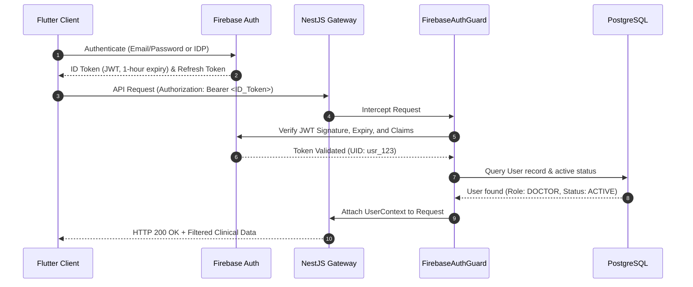
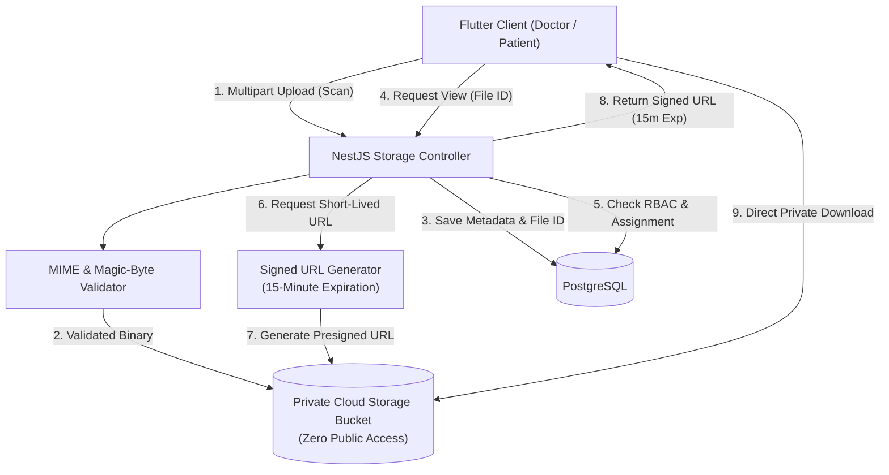

# Lumyra — Security, Privacy & Healthcare Compliance Specification

**Product Name**: Lumyra — Cross-Platform Breast Health Companion  
**Version**: 1.0.0  
**Classification**: Confidential / Healthcare Architectural Standard  
**Date**: October 2026  

---

## 1. Regulatory Context and Healthcare Compliance

Lumyra processes sensitive medical and personal data (Protected Health Information - PHI / Special Category Data). The system architecture complies with global and regional data protection regulations:

1. **HIPAA Security & Privacy Rules (45 CFR Parts 160 & 164)**:
   - Technical safeguards: Access control (§ 164.312(a)), audit controls (§ 164.312(b)), integrity (§ 164.312(c)), transmission security (§ 164.312(e)).
   - Minimum necessary disclosure standard: Users only access data strictly required for their specific role.
2. **GDPR (Regulation (EU) 2016/679 - Article 9)**:
   - Processing of special categories of personal data (health data) requires explicit consent, robust technical safeguards, and right to erasure mechanisms.
3. **Egyptian Personal Data Protection Law (Law No. 151 of 2020)**:
   - Sensitive personal health data protections, requiring explicit data subject authorization, local data handling standards, and transparent processing logs.

---

## 2. Threat Modeling & Identified Vulnerabilities

Following our audit of the reference repository `HopeCompanion`, specific threat vectors were identified and remediated in Lumyra's core architecture:

| Threat Vector | Reference Repo Vulnerability | Lumyra Remediation Architecture |
| :--- | :--- | :--- |
| **Insecure Direct Object Reference (IDOR)** | Client queries Firestore directly using user-supplied IDs without backend authorization checks. | **Resource-Level Authorization Guards**: Backend interceptors verify that the requesting user's identity token matches the target patient ID or an active `DoctorPatientAssignment`. |
| **Public Exposure of Medical Images** | Uploaded mammograms stored with `fileRef.makePublic()` and 1-year public signed URLs. | **Private Cloud Buckets & Short-Lived Signed URLs**: Storage buckets configured with uniform bucket-level access; zero public read permissions. Presigned read URLs strictly capped at 15 minutes. |
| **Unsanitized File Upload Attacks** | File uploads processed solely based on client-provided MIME string. | **Magic-Byte Inspection & File Quarantine**: Backend validates file headers against known binary signatures for JPEG, PNG, WEBP, and DICOM before moving from temporary quarantine to private storage. |
| **Privilege Escalation** | Client-side role claims stored in unverified Firestore documents. | **Cryptographically Verified Roles**: User roles are resolved and enforced on every API request by cross-referencing Firebase Auth UIDs against the PostgreSQL primary database. |
| **Credential & Secret Leakage** | API keys and tokens committed or loaded into client bundles. | **Server-Side Secret Isolation**: Zero third-party API keys (Gemini, Google Maps, Firebase Admin) shipped in Flutter client code. All external interactions proxy through authenticated NestJS endpoints. |
| **Audit Amnesia** | No systematic audit logging of who viewed patient records or downloaded scans. | **Immutable Audit Log Engine**: Structured PostgreSQL audit tables capturing actor, timestamp, IP address, user agent, target resource, and action type. |

---

## 3. Identity, Authentication & Session Lifecycle



### 3.1 Token Lifespan & Renewal
- Firebase ID Tokens carry a strict **1-hour expiration time**.
- The Flutter client utilizes an automated Dio interceptor to refresh expired tokens seamlessly via the Firebase SDK without prompting the user, unless the session has been revoked or expired past the refresh window.
- Sensitive operations (e.g., password reset, email change, account deletion) require recent re-authentication (< 5 minutes).

### 3.2 Secure Client Storage
- On Android, auth tokens and refresh keys are stored using `EncryptedSharedPreferences` backed by the Android Keystore system.
- On iOS, secrets are persisted to the **iOS Keychain** with `kSecAttrAccessibleAfterFirstUnlock`.
- On Flutter Web, sensitive credentials are kept strictly in memory or session-scoped Web Cryptography API storage to mitigate XSS exposure.

---

## 4. Role-Based & Resource-Level Authorization (RBAC)

Access control is enforced at the NestJS backend on every route. UI element hiding is treated as a visual convenience, never as a security boundary.

### 4.1 Role Definitions
1. **Patient (`Role.PATIENT`)**:
   - May read and update only their own patient profile, journal entries, risk assessments, and medication adherence logs.
   - May view their own appointments and schedule new appointments with approved doctors.
   - May view authorized educational articles and public medical centers.
   - **Forbidden**: Viewing other patients' data, viewing doctor-only clinical notes, accessing administrative endpoints.
2. **Doctor (`Role.DOCTOR`)**:
   - Must hold `Status.ACTIVE` (verified and approved by an Administrator).
   - May access medical charts, appointments, and image analyses **ONLY** for patients assigned to them via `DoctorPatientAssignment`.
   - May create, edit, and publish educational articles.
   - May submit clinics for directory inclusion.
   - **Forbidden**: Accessing unassigned patient records, modifying system configuration, approving other doctors.
3. **Administrator (`Role.ADMIN`)**:
   - May review doctor registration requests, inspect submitted medical licenses, and approve/reject credentials.
   - May manage the medical center directory, educational content categories, and system configuration.
   - May inspect operational health metrics and audit trails.
   - **Strict Privacy Barrier**: Administrators **CANNOT** view private patient journal entries or medical image scans. Any clinical data access requires explicit Break-Glass authorization logged to the audit repository.

### 4.2 Resource Authorization Matrix

| Resource / Action | Patient | Doctor (Assigned) | Doctor (Unassigned) | Administrator |
| :--- | :---: | :---: | :---: | :---: |
| Read Own Patient Profile | **ALLOW** | **ALLOW** | **DENY** | **DENY** (PVI Protected) |
| Read/Write Personal Journal | **ALLOW** | **ALLOW** (If shared) | **DENY** | **DENY** |
| Submit Risk Assessment | **ALLOW** | **DENY** | **DENY** | **DENY** |
| Review Risk Assessment Results | **ALLOW** (Own) | **ALLOW** | **DENY** | **DENY** |
| Upload Medical Image Scan | **ALLOW** (Own) | **ALLOW** (For patient) | **DENY** | **DENY** |
| Run Secondary AI Image Review | **DENY** | **ALLOW** | **DENY** | **DENY** |
| Access Short-Lived Image URL | **ALLOW** (Own) | **ALLOW** | **DENY** | **DENY** |
| Approve Doctor Registration | **DENY** | **DENY** | **DENY** | **ALLOW** |
| Manage Medical Center Registry | **DENY** | **DENY** (Submit only) | **DENY** | **ALLOW** |
| View System Audit Logs | **DENY** | **DENY** | **DENY** | **ALLOW** |

---

## 5. Medical File Storage & Short-Lived URL Security

Medical images (mammograms, ultrasounds, biopsies) represent critical high-risk assets. Lumyra enforces a strict object storage security lifecycle:



### 5.1 Storage Rules & Safeguards
1. **Zero Public Access**: The storage bucket configuration strictly blocks all public reads and list requests.
2. **Short-Lived Signed URLs**: Presigned URLs are generated on demand with an explicit expiration of **900 seconds (15 minutes)**. URLs are never stored in database tables or logs.
3. **Upload Validation**:
   - Allowed file extensions: `.jpg`, `.jpeg`, `.png`, `.webp`, `.dcm` (DICOM).
   - Maximum upload size: **25 MB** for single scans; **50 MB** for multi-slice DICOM archives.
   - Binary validation: Validates file headers (magic bytes) to prevent executable upload disguise (e.g., verifying `FF D8 FF` for JPEG, `89 50 4E 47` for PNG).
4. **Data Isolation**: Files are partitioned on storage paths by patient UUID: `patients/{patientId}/medical_scans/{scanId}.ext`.

---

## 6. Data Encryption & Safe Logging Policy

### 6.1 Encryption Standards
- **In Transit**: All network communication (mobile-to-API, web-to-API, API-to-database, API-to-storage) requires **TLS 1.3** with modern cipher suites (PFS, ECDHE-RSA-AES128-GCM-SHA256 or better). Plain HTTP is rejected.
- **At Rest**:
  - PostgreSQL volumes encrypted using **AES-256** (Transparent Data Encryption / AWS KMS / GCP Cloud KMS).
  - Cloud storage objects encrypted with **AES-256 (SSE-S3 / SSE-KMS)**.
  - Highly sensitive fields (e.g. emergency contact phone numbers, journal notes) support application-level encryption using AES-GCM before writing to database columns.

### 6.2 Safe Logging Policy (Zero PHI Leakage)
To prevent accidental exposure in log management tools (Datadog, CloudWatch, ELK), the NestJS `LoggingInterceptor` enforces strict sanitization:
- **Redacted Fields**: Passwords, tokens, `Authorization` headers, credit card numbers, national identification numbers, and raw journal content are masked with `[REDACTED]`.
- **Log Levels**: Request metadata (method, route, response status, latency, request ID) logged at `INFO`. Database query logs in production exclude variable parameter substitutions.
- **Error DTOs**: Unhandled 500 exceptions return a generic user-friendly message (`"An unexpected error occurred. Reference ID: <UUID>"`) while logging the stack trace internally with correlation IDs.

---

## 7. Audit Trail & Traceability

Every sensitive access event is recorded to the immutable `audit_events` table in PostgreSQL.

### 7.1 Audited Events
- User login, logout, and failed authentication attempts.
- Viewing a patient's medical profile or clinical records.
- Generating a signed URL to view or download a medical image.
- Executing an AI medical image analysis job.
- Modifying medication schedules or appointment records.
- Administrator approval or rejection of doctor registration.
- Any administrative export of aggregated system data.

### 7.2 Audit Schema Structure
```typescript
interface AuditRecord {
  id: string;              // UUIDv4
  timestamp: Date;         // UTC ISO8601
  actorId: string;         // User UUID performing action
  actorRole: Role;         // Role at the time of action
  action: AuditAction;     // e.g. READ_PATIENT_RECORD, DOWNLOAD_IMAGE
  targetEntity: string;    // e.g. PatientProfile, MedicalFile
  targetId: string;        // ID of the target resource
  ipAddress: string;       // Client IP (anonymized if required)
  userAgent: string;       // Client application & OS signature
  status: 'SUCCESS' | 'FAILURE' | 'DENIED';
  metadata?: Record<string, any>; // Non-sensitive context
}
```

---

## 8. Synthetic Data Policy & Development Boundaries

1. **Absolute Prohibition of Real Patient Data**: Development, staging, and automated test environments **MUST NEVER** use real patient information or genuine diagnostic mammograms.
2. **Synthetic Data Generation**: All test profiles, risk assessments, journal entries, and sample scans are created using synthetic data generators (`@faker-js/faker`, synthetic medical imaging test cards).
3. **Data Retention & Right to be Forgotten**: Lumyra implements clean cascading account deletion routines that purge personal identifiers, anonymize aggregate statistics, and delete private storage objects when a patient requests account closure.
